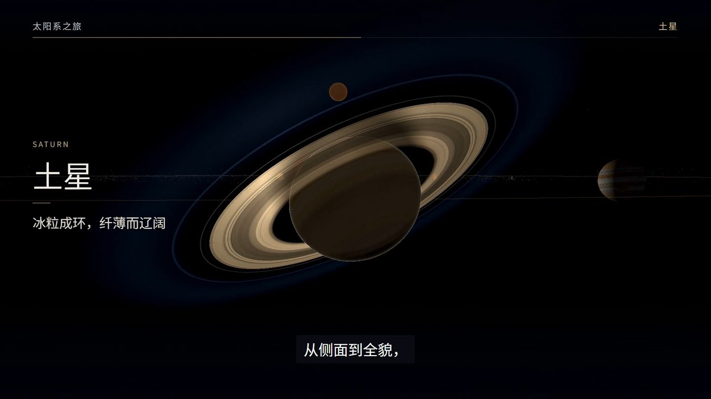

# Material2Video

[中文](README.md)

**Turn articles, data, and media into editable short videos.**

Use a storyboard to organize the content and code to create the visuals. Keep the media, subtitles, and finished video together in a project that can run on its own.



**[Watch the examples][video-gallery]** · **[Make your first video](#make-your-first-video-in-three-minutes)** · **[Explore the source](ARCHITECTURE.md)**

## Examples

| Work | Type | Length | What to watch for |
| --- | --- | ---: | --- |
| [40 Years of Compound Interest](examples/data-evolution/compound-after-20/README.md) | Data evolution | 38.7 s | Interest bars grow from zero, then form two towers that explain the 6.73× difference between the two 20-year periods. [Video page][video-compound-after-20] |
| [Global Top 10 by Market Cap](examples/data-evolution/global-market-cap-race-portrait/README.md) | Data evolution | 107.13 s | Follow rankings from 2000 to 2026 and see how the lead changes in a portrait layout with room for platform overlays. [Video page][video-global-market-cap-race-portrait] |
| [What Is Luck?](examples/principle-metaphor/luck-on-stage/README.md) | Principle metaphor | 41 s | A hit, a probability dial, and a three-bar comparison explain the expected number of successes. [Video page][video-luck-on-stage] |
| [Solar System Journey](examples/spatial-3d/solar-system-journey/README.md) | Spatial 3D | 120 s | Travel through 15 stops, from the Earth–Moon relationship to a reveal of Saturn’s rings and the scale of the outer Solar System. [Video page][video-solar-system-journey] |
| [From Telegraphs to Large Language Models](examples/documentary-edit/american-science-milestones/README.md) | Documentary edit | 30 s | A museum telegraph tape opens an archival sequence of ten milestones, then reappears in the finale. [Video page][video-american-science-milestones] |

The gallery includes silent excerpts and preview frames. Each example README includes its storyboard, design notes, and recovery steps. [View the gallery locally](docs/site/README.md)
All five examples can be restored and exported as standalone projects. [Example index and reproduction steps](examples/README.md)

## Make your first video in three minutes

Start with a three-second title video. The first dependency, font, and browser downloads take extra time depending on your connection.

You need Python 3.11 or later, uv, Node.js 22.12 or later, and pnpm 10.15.0.
From the repository root, run the same initialization command in PowerShell or bash.

```text
uv run m2v init --type text-motion --project demo
```

Open the generated `videos/text-motion/demo/` folder and edit two files.

1. In `storyboard.json`, replace the empty object at `scenes[0].content.props`
   with `{"title": "My First Video"}`. The opening scene reads its on-screen title from this field.
2. In `scenes/opening.tsx`, change `background: '#0b0d12'` to
   `background: '#17365d'` to set the canvas color.

From the repository root, run the block for your shell. The last command renders and exports the video.

**PowerShell**

```powershell
Push-Location videos/text-motion/demo
pnpm install --frozen-lockfile --ignore-workspace
uv sync --frozen
pnpm run setup --download --install-browser
pnpm run render
Pop-Location
```

**bash**

```bash
(
  cd videos/text-motion/demo &&
  pnpm install --frozen-lockfile --ignore-workspace &&
  uv sync --frozen &&
  pnpm run setup --download --install-browser &&
  pnpm run render
)
```

Open `videos/text-motion/demo/outputs/video.mp4` from the repository root to see your new title and color.
Keep editing the storyboard and scene source, then export again from the same project. [Environment and asset recovery](templates/standalone/README.md)

## How it works

Start with articles, data, and media. The storyboard sets scene timing and points to the scene source.
That code controls layout, camera, lighting, and motion. Capture records the rendered visuals frame by frame.
The project’s `SceneFilm` composition assembles the clips, transitions, and subtitles before audio mixing and export.
Each project runs with its own source, dependency locks, and asset recovery scripts.
[Architecture and module responsibilities](ARCHITECTURE.md)

## Current capabilities

Five video types share a standalone project foundation. Each project adopts the components and media it needs.

- `text-motion` generates text and graphics in code for typography and motion.
- `data-evolution` visualizes changes in structured data.
- `principle-metaphor` uses generated objects and scenes to explain abstract ideas.
- `spatial-3d` renders 3D models and spaces.
- `documentary-edit` builds narratives from footage, photos, and archival material.

Create visuals in code or edit recorded media. Map routes and situational storytelling are available as techniques.
Projects support clip previews and full exports, synthesized narration, and bilingual subtitles with an adaptive halo.

## Documentation

The [technical reference index](docs/reference/README.md) groups the detailed guides by topic.

- [Project model and storyboard](docs/reference/project-model.md) covers versions, source references, dependency locks, and asset recovery.
- [Voice and subtitles](docs/reference/voice-and-subtitles.md) covers voice backends, reference voices, bilingual subtitles, and adaptive halos.
- [Native web samples and media review](docs/reference/sample-and-review.md) covers capture, preview, review, and delivery.
- [Materials, attribution, and project storage](docs/reference/materials.md) covers sourcing records, adoption policy, caches, and paths.

The [production skill](.agents/skills/material2video/SKILL.md) describes the production stages and their requirements.
See the [OpenSpec specifications](openspec/specs/) for current behavior and the [project plan](docs/PROJECT_PLAN.md) for future work.

## Contributing and licensing

Feedback on production or reproduction issues is welcome, along with improvements to the docs, examples, and tools.
[CONTRIBUTING.md](https://github.com/haoaoqikf/material2video/blob/main/CONTRIBUTING.md) will arrive in Phase C.
See [AGENTS.md](AGENTS.md) for the repository’s verification and commit conventions.

Original code, documentation, example source, and original scripts use the [MIT License](LICENSE).
Remotion is licensed separately. Other materials with licensing notices follow their stated terms.
See the [third-party notices](THIRD_PARTY_NOTICES.md) for dependencies, fonts, models, and example media.

[video-gallery]: https://haoaoqikf.github.io/material2video/
[video-compound-after-20]: https://haoaoqikf.github.io/material2video/work-compound.html
[video-global-market-cap-race-portrait]: https://haoaoqikf.github.io/material2video/work-market-cap.html
[video-luck-on-stage]: https://haoaoqikf.github.io/material2video/work-luck-on-stage.html
[video-solar-system-journey]: https://haoaoqikf.github.io/material2video/work-solar-system.html
[video-american-science-milestones]: https://haoaoqikf.github.io/material2video/work-american-science.html
