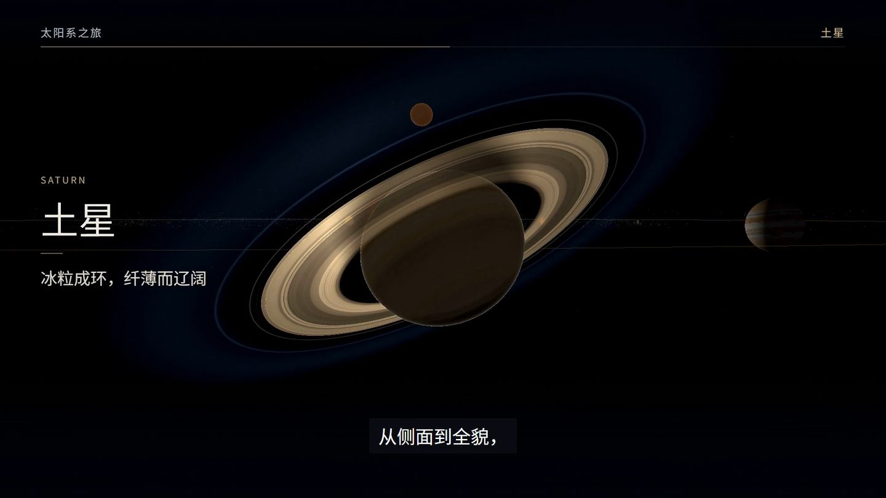

# Material2Video（材料成片）

[English](README.en.md)

**把文章、数据和素材做成可编辑的短视频。**

用分镜组织内容，用代码制作画面，把素材、字幕和成片保存在一个能独立运行的工程里。



**[看作品][video-gallery]** · **[做第一个视频](#三分钟做出第一条视频)** · **[制作流程](.agents/skills/material2video/SKILL.md)** · **[架构](ARCHITECTURE.md)**

## 示例作品

| 作品 | 类型 | 时长 | 看什么 |
| --- | --- | ---: | --- |
| [复利 40 年](examples/data-evolution/compound-after-20/README.md) | 数据演化 | 38.7 秒 | 年度利息柱从零线生长，前后二十年归为两塔，解释 6.73 倍的差距。 [成片页][video-compound-after-20] |
| [全球市值前十](examples/data-evolution/global-market-cap-race-portrait/README.md) | 数据演化 | 107.13 秒 | 在竖屏上跟踪 2000–2026 年的排名变化，观察榜首交接与平台叠层留白。 [成片页][video-global-market-cap-race-portrait] |
| [太阳系之旅](examples/spatial-3d/solar-system-journey/README.md) | 三维空间 | 120 秒 | 连续经过十五站，观察地月关系、土星环的视角揭示与外层尺度。 [成片页][video-solar-system-journey] |

作品集提供静音片段及预览帧。也可以打开任一作品说明，查看它的分镜、设计材料和恢复步骤。 [本地查看作品集](docs/site/README.md)
三部示例都能作为独立工程恢复和导出。 [随附示例与复现说明](examples/README.md)

## 三分钟做出第一条视频

先用图文动效模板做一条三秒标题视频。这里的「三分钟」指最短上手路径，不是耗时保证；依赖、字体、浏览器和首次打包都可能增加等待时间。

**准备环境。** 使用 `git clone` 检出的仓库，保留 `.git`；GitHub 的源码 ZIP 不能直接用于 `m2v init`。需要 Python 3.11+、uv、Node.js 22.12+ 和 pnpm **10.15.0**；用 `pnpm --version` 核对，不用跟随安装时的升级提示。若用 npm 管理 pnpm，可用 `npm install --global pnpm@10.15.0` 安装指定版本。

**先备字体。** 本模板的 `Inter-Variable.ttf` 和 `NotoSansSC-Variable.ttf` 未登记自动下载地址。准备与 [字体登记](fonts/registry.json) 摘要一致的文件，设置 `M2V_FONT_CACHE` 指向该目录（本机复用已恢复的 `fonts/files/`），也可以在初始化后放入作品的 `fonts/.cache/`。`--download` 不会代替这一步，系统字体也不会替补。PowerShell 用 `$env:M2V_FONT_CACHE = '字体缓存的绝对路径'`；bash 用 `export M2V_FONT_CACHE='/字体缓存的绝对路径'`。

**安装并初始化。** 从仓库根目录依次运行；下面的命令在 PowerShell 和 bash 中逐行相同，任一步失败先停下处理。PowerShell 若拦截 `pnpm.ps1`，改用 `pnpm.cmd`，不必修改执行策略。

```text
uv sync
uv run m2v init --type text-motion --project demo
cd videos/text-motion/demo
pnpm install --frozen-lockfile --ignore-workspace
uv sync --frozen
pnpm run setup --download --install-browser
```

在作品目录安装依赖，不要在仓库根目录运行后面三条。若设置了独立内容根，进入 `m2v init` 打印的作品目录。若渲染提示缺 Chromium，在该作品目录重跑上面的 `setup` 命令；它安装该作品所用 Playwright 版本匹配的 Chromium，不使用系统浏览器。

**改样并导出。** 在作品目录改两处内容：

1. 在 `storyboard.json` 的第一幕找到 `scenes[0].content.props`，
   将空对象换成 `{"title": "我的第一条视频"}`。开场场景从这个字段读取屏幕标题。
2. 在 `scenes/opening.tsx` 把 `background: '#0b0d12'` 改为
   `background: '#17365d'`，用这个颜色作为整张画布的主色。

仍在作品目录运行：

```text
pnpm run render
```

成片在作品的 `outputs/video.mp4`，默认从仓库根目录看是 `videos/text-motion/demo/outputs/video.mp4`。若 Windows 的播放器提示 `0x80070005`，检查成片所在目录对当前用户的读取权限；也可以在同一个终端用 `ffprobe` 核对文件。继续编辑分镜和场景源码后，在同一作品目录重新导出。 [环境与资源恢复说明](templates/standalone/README.md)

**本机实测：Windows 11 / Node 22.23.2 / pnpm 10.15.0**（Python 3.14.9、uv 0.9.11）。在临时干净克隆中首次安装至 `setup` 就绪 **37.76 秒**，改标题与主色至导出 **154.75 秒**，定位成片并运行 `ffprobe` **0.22 秒**。成片为 **3.000 秒、1920×1080、32,284 字节**。计时不含克隆或取得字体，复用了本机已有的依赖缓存和 Chromium，不是无缓存下载耗时。Linux 和 macOS **未在此环境验证**。

也可以把[十秒竖屏文字动效任务](docs/agent-quickstart.md)交给编码助手，按制作 Skill 完整走一遍。

## 它是怎么工作的

材料提供文章、数据和媒体，分镜把材料编排为有时序的场景并指向对应源码。
场景源码控制排版、相机、光影与动效，采集按帧记录实际绘制的画面，
再由作品内的 `SceneFilm` 合成片段、转场和字幕，最后混音并写出成片。
作品自带运行源码、依赖锁和资源恢复入口，可在作品目录独立运行。
[架构与模块职责](ARCHITECTURE.md)

## 当前能力

`m2v types` 列出每类的默认参考及修订。图文动效采用 IBM 动态排版，数据演化采用 Apple Keynote 演示，三维空间采用 NASA SVS 科学可视化。初始化把参考清单和发布摘要封存在工程的 `design/style-binding.json` 与 `design/style-release.json`。已有工程按本地修订校验；新准备包含绑定文件摘要。

<!-- generated:type-catalog:start -->
- `text-motion`：代码生成文字和图形，侧重排版与动效
- `data-evolution`：结构化数据的可视化变化
- `spatial-3d`：三维模型和场景的空间渲染
<!-- generated:type-catalog:end -->

可以制作代码画面，也可以剪辑登记过的真实媒体。地图轨迹和情境叙事可用作表现手法。
作品支持局部预览与完整导出。配音可由声音后端合成，带字幕的作品可使用双语字幕与自适应柔光。

## 文档导航

[技术文档索引](docs/reference/README.md)按以下主题整理工程细节与操作入口。

- [独立工程与分镜](docs/reference/project-model.md)涵盖工程版本、来源引用、依赖锁和资源恢复。
- [声音与字幕](docs/reference/voice-and-subtitles.md)涵盖配音后端、参考音色、双语字幕和柔光。
- [网页原生设计样品与媒体评审](docs/reference/sample-and-review.md)涵盖采集、预览、评审与交付。
- [素材、署名与作品存储](docs/reference/materials.md)涵盖素材台账、采用政策、缓存和目录。

制作顺序与各阶段契约见[制作 Skill](.agents/skills/material2video/SKILL.md)。
已实现行为见 [OpenSpec 规格](openspec/specs/)，后续路线见[项目规划](docs/PROJECT_PLAN.md)。

## 参与与许可

欢迎反馈制作与复现中的问题，或参与改进文档、示例和工具链。
[贡献指南](CONTRIBUTING.md)介绍开发验证和维护者发布流程；[首发说明](docs/release-notes/v0.1.0.md)列出能力和复现边界。
仓库内的验证与提交约定见 [AGENTS.md](AGENTS.md)。

原创代码、文档及示例源码和原创文案采用 [MIT 许可证](LICENSE)。
Remotion 独立授权，其他另有许可标注的内容沿用各自声明。
依赖、字体、模型与示例素材的许可见[第三方声明](THIRD_PARTY_NOTICES.md)。

[video-gallery]: https://haoaoqikf.github.io/material2video/
[video-compound-after-20]: https://haoaoqikf.github.io/material2video/work-compound.html
[video-global-market-cap-race-portrait]: https://haoaoqikf.github.io/material2video/work-market-cap.html
[video-solar-system-journey]: https://haoaoqikf.github.io/material2video/work-solar-system.html
